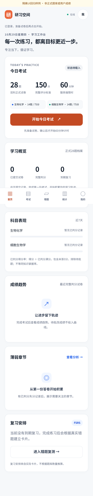
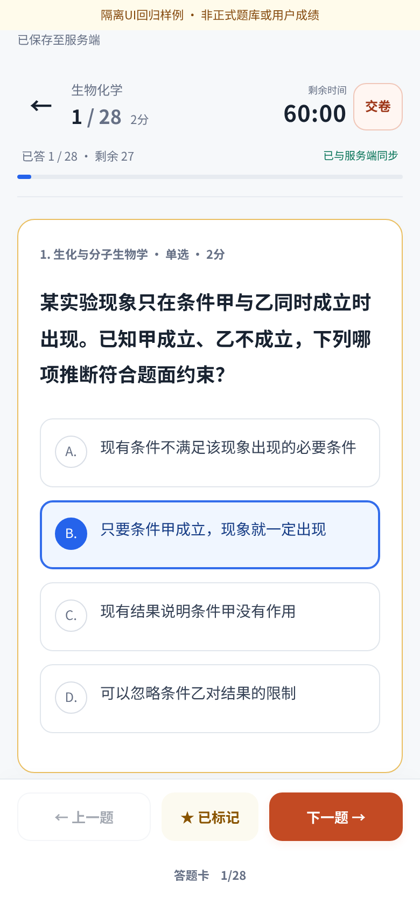
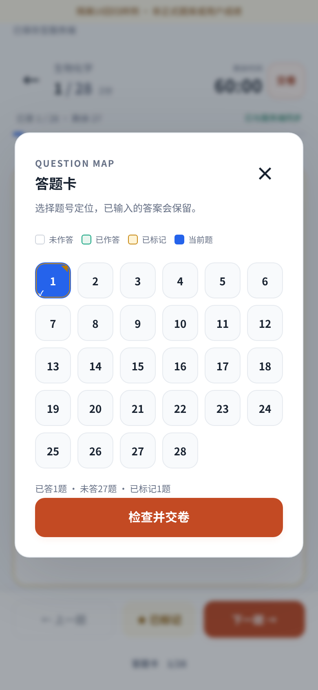
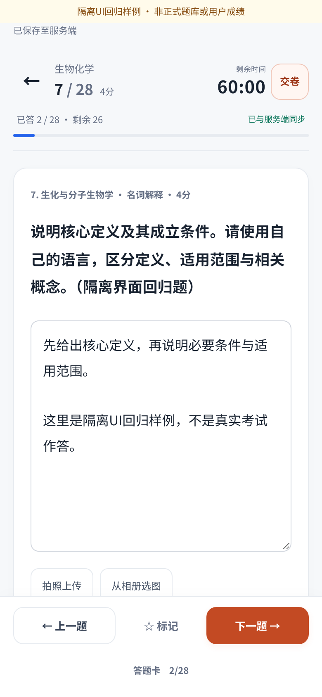
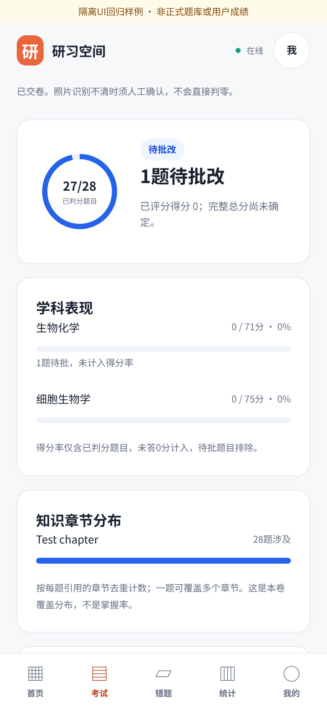
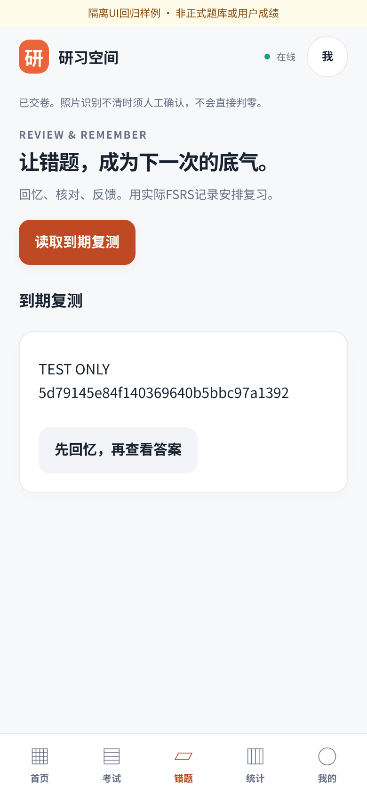

# 方案四：Learning Analytics Dashboard 审阅包

本改版仅在独立分支实现，未部署Railway。正式28题、150分、60分钟及两科3/3/4/3/1配额不变；没有修改后端路由、数据库、题目、成绩、审核、计费或FSRS算法。

## PR初审修复（2026-10-29）

- **开始前只显示须知和配额**：`training.js`在非`in_progress`状态不创建题目DOM；`training-ui.js`同时隐藏并禁用题目区、工具栏、答题卡及导航。初始HTML也默认隐藏，避免脚本初始化时闪现。
- **开始成功才解锁**：确认按钮等待服务端`start`返回有效状态，处理中禁止连点；HTTP失败或未确认状态均不显示题目。刷新同步到另一设备的开始状态时正常渲染，仍使用原服务端deadline。
- **清理计时前本机预答**：只针对当前用户、当前未开始试卷清理localStorage文字/标记和IndexedDB待上传照片，不修改任何服务器记录。恢复已开始试卷时，只合并同一开始时间的`in_progress`缓存，拒绝另一设备开始前遗留的缓存。既有已开始答卷的离线草稿保留。
- **服务端保护无需修改**：当前代码原已在`load_paper`的`not_started`响应中移除题目；保存、图片和交卷均经过`assert_writable`。新增独立PostgreSQL回归验证三种操作在开始前全部拒绝且不产生记录。因此本轮没有后端应用代码、迁移或正式数据修改。
- **iPhone首页**：压缩顶部导航高度、标题字号及上下留白，保留白色数据卡片和橙色核心入口；390px下首页标题改为单行。
- 保留主观待批`score=null`、真实统计分母与空状态。所有截图继续使用明确标记的隔离合成夹具。

|复核点|初审版本ca4edd2|本轮修复|
|---|---|---|
|iPhone首页密度|[初审首页](screenshots/review-before-home-390.png)|[压缩后首页](screenshots/after-home-390.png)|
|确认开始前|[初审须知页](screenshots/review-before-prepared-390.png)|[仅须知与确认开始](screenshots/after-prepared-390.png)|

针对性回归：**46 passed**；本轮最终全量：**518 passed，1项既有Starlette弃用警告**。覆盖四视口、未开始缓存注入/清理、失败开始、离线未开始恢复、另一设备开始后缓存隔离、服务端拒绝预答、中文composition/光标、模拟VisualViewport键盘避让、相机和相册输入上传、离线文字/照片恢复、倒计时、版本冲突与重复提交。

未接触正式试卷ID1、线上数据库或历史记录。相机/相册使用浏览器文件输入夹具，键盘用VisualViewport和composition事件模拟；这些不是实体iPhone系统相机或中文输入法验收，真机Safari验收仍保留。

## 先看界面

所有截图来自本地独立测试数据库和真实HTTP浏览器。**题目和成绩均为明确标记的合成UI回归夹具，不是真实题库、教材、用户答卷或正式AI审核。** 改版前标题已脱敏。截图没有凭据，未访问线上正式试卷。

|场景|改版前|改版后|
|---|---|---|
|iPhone首页|[原始首页](screenshots/before-home-390.png)|[数据仪表盘](screenshots/after-home-390.png)|
|iPhone单选|[原始答题页](screenshots/before-exam-390.png)|[专注答题](screenshots/after-choice-390.png)|
|iPad|[原始长页](screenshots/before-exam-834.png)|[仪表盘](screenshots/after-home-834.png) · [主观题](screenshots/after-subjective-834.png)|

### 首页、专注考试与题号导航

|首页仪表盘|单选与选中状态|题号导航|
|---|---|---|
||||

### 主观题、成绩与错题

|主观题编辑|待批改与真实统计|错题复测|
|---|---|---|
||||

补充：[准备后尚未计时](screenshots/after-prepared-390.png)、[大屏iPhone 430×932](screenshots/after-choice-430.png)、[章节与失分分析](screenshots/after-result-analysis-390.png)、[iPad结果](screenshots/after-result-834.png)、[我的与高级入口](screenshots/after-profile-390.png)、[桌面1440×900](screenshots/after-home-1440.png)。高保真稿先于实际实现制作：[移动端视觉稿](screenshots/prototype-mobile.png) · [独立HTML视觉稿](prototype.html)。

## 设计与真实数据口径

- 橙色品牌与核心操作、蓝色图表与选中状态、绿色同步、橙黄倒计时警示；白色卡片与8px间距体系。主按钮采用同色系深橙确保白字对比度，品牌保留#EA653B。
- 首页、考试、错题、统计、我的；手机底部导航，iPad/桌面侧栏。考试专注时收起全局导航，保留当前题、科目、分值、原倒计时、保存状态和答题卡。
- 首页仅使用既有只读API：`/v2/history`、`/v2/stats/weekly`、`/v2/memory/due`。未载入试卷时显示“状态待载入”，不推断其是否存在；不会为了展示卡片而偷偷准备或开始考试。
- 已提交数基于接口最近100份正式28题档案；完整判分数只计非空数值总分；到期复习只计真实FSRS到期项，不代表全部历史错题。请求失败保留未知，不显示假0。
- 科目表现为近7天**已判分得分率**，分母是API的已判分满分，包含未答0分，排除待批改。不标为掌握率。周统计沿用既有API按每题首个引用章节分组的口径。
- 成绩趋势仅绘制最近10份完整判分的正式150分记录；不足2份时展示空状态。旧制60分档案保留只读入口，不混入趋势。
- 结果环图显示已判分题数，不是正确率。主观待批时总分仍为null；科目条形图也排除待批题。章节分布按每题引用章节去重计数，一题可覆盖多个章节，不代表掌握程度。
- 已作答失分、未答、待批分别列示。不从分数臆测错因；既有接口没有错因分类汇总时，明确说明并保留逐题复盘记录入口。

## 保持原有考试能力

计时仍由原server_now、deadline和performance锚点驱动，没有新建独立计时器。准备与确认开始为两步，确认交卷只换为可访问性对话框，提交仍调用原有幂等接口。

全部28道题的DOM保留，一题一屏只切换可见性；题号状态从现有草稿实时派生，位置仅在本机会话中记录。没有分页API、复制试卷或新答案状态库。

中文composition期间先保存本机草稿，结束后走原flush队列。输入控件聚焦时不后台重建题目；版本不匹配仍由原409保护，不能覆盖另一设备。已提交结果未变化时不重建解析，避免每15秒折叠详情、打断复盘或强制跳页。

照片仍使用原IndexedDB暂存、原上传接口与原版本保护。新的CSS/JS已加入原service worker白名单并更新缓存版本；不缓存API结果或教材答案。原历史档案、错题复测、学习建议、周统计、归档和模型设置均可进入；模型/审核高级页面的业务控制不变。

## 验收与限制

本地最终全量：**518 passed，1项既有Starlette弃用警告**（初审版本为514项）。四视口与完整答题/图片/离线/幂等流程使用真实Chromium浏览器和独立PostgreSQL17。

WebKit已在工作区启动并实际渲染页面，但本地HTTP夹具下其拒绝Secure Cookie，完整登录流程无法作为Safari HTTPS验收。没有为此关闭产品Secure Cookie或修改鉴权；不把测试夹具适配尝试计为产品验收通过。实体iPhone Safari的HTTPS、中文键盘和系统相册仍需发布前实际确认。

- 本地独立PostgreSQL测试库，不是正式数据库；继续运行全部原测试，原手机用例只适配题号导航与交卷对话框，没有删除保存、上传、评分或幂等断言。
- 新增四视口、准备与开始分离、导航/标记/选项键盘、中文composition、焦点/光标、多设备冲突、待批口径、真实图表分母、读取失败不造0、减少动画和结果刷新稳定性回归。
- 390×844、430×932、834×1194、1440×900实际浏览器验证无横向溢出。底部安全区域留白、输入滚动余量、VisualViewport键盘避让、44px触控、焦点、radiogroup与对话框标签已实现。
- 浏览器视口、合成composition事件不等于实体iPhone Safari键盘或系统相册验收；正式发布前仍需用户真实设备确认。

截图复现（只允许显式loopback测试库）：

```sh
cd backend
TEST_DATABASE_URL='<本地独立测试库连接>' python tests/capture_learning_ui.py --output ../docs/ui-learning-analytics/screenshots
python -m pytest -q
```

截图工具只调整隔离夹具的展示文案，并明确标记样例；不把这些文案或成绩作为产品默认数据。

## 发布边界

新UI分支/PR只供审阅，不合并main或原开发分支，不改Railway源提交与变量。创建PR前只读核验两个项目PR预览均关闭，隔离API无仓库推送触发器。线上仍应保持9f18b8c，待用户确认后另行安排发布。
